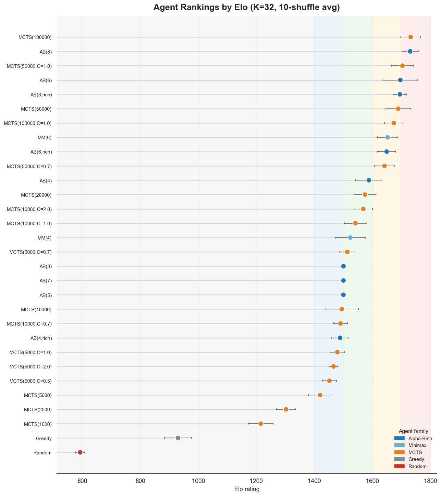
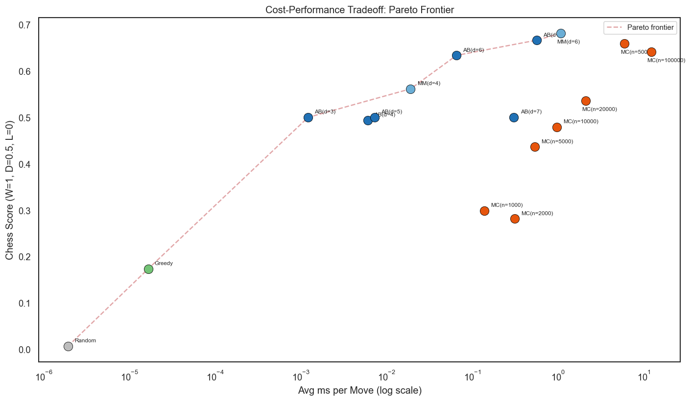
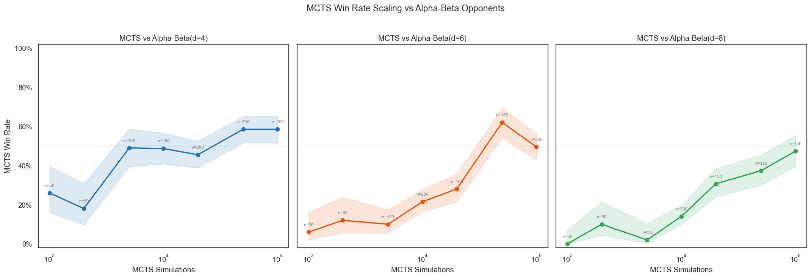
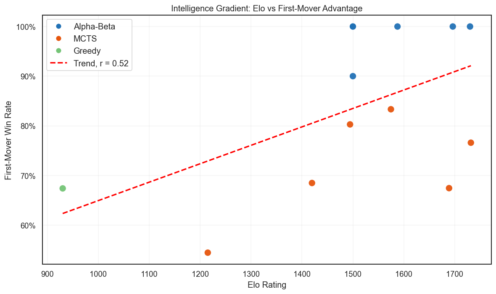
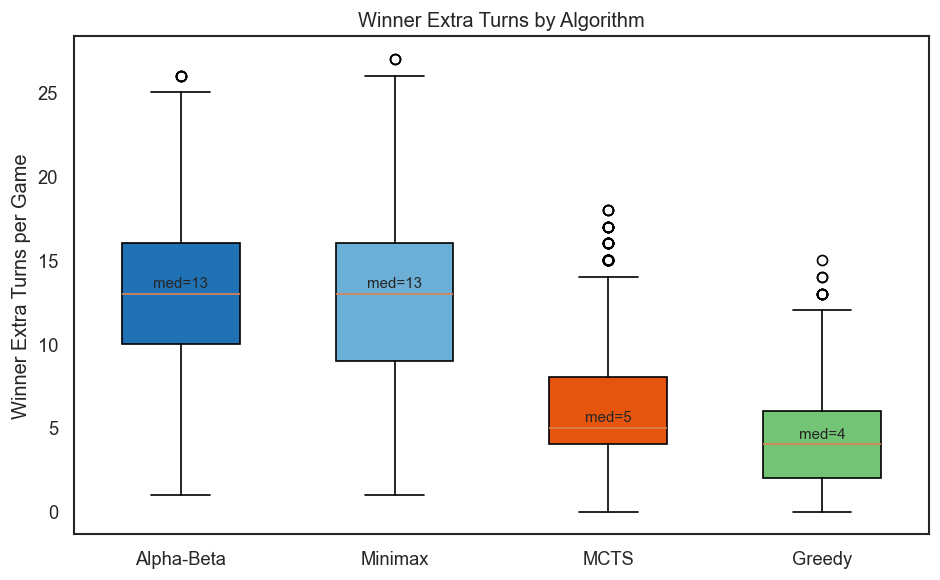

# Mancala AI: Comparing Game-Playing Agents (Minimax, Alpha-Beta, MCTS)

A from-scratch Mancala (Kalah) engine with five AI agents, evaluated in a **9,408-game tournament** across 30 agent configurations. The study asks practical search questions:
- How much faster is alpha-beta than minimax?
- Where does deeper search stop paying off?
- How many simulations does Monte Carlo Tree Search (MCTS) need to keep up?
- Why does moving first matter more for stronger agents?



| | |
|---|---|
| **Context** | Foundations of Artificial Intelligence (AI 801), Penn State, Spring 2026 |
| **Team** | Shuyang Huang, Elliott Armstrong, Matthew Kolker |
| **Agents** | Random · Greedy · Minimax · Alpha-Beta (with move ordering) · MCTS (UCT) |
| **Scale** | 30 agent configurations · 117 matchups · 9,408 games |
| **Stack** | Python (engine uses the standard library only), pandas, SciPy, seaborn |
| **Outputs** | [Report (PDF)](docs/report.pdf) · [Slides (PDF)](docs/slides.pdf) |

## My Role

- Implemented the **Minimax** and **Alpha-Beta pruning** agents.
- Wrote the report's **related work**, **importance & impact**, and **data collection & preprocessing** sections.
- Built **result visualizations** for the report.

## Key Findings

| Question | Finding |
|---|---|
| Does alpha-beta pruning help? | **3× faster at depth 4 and 16× faster at depth 6**, with no change in playing strength (head-to-head p = 0.67 and 0.89). |
| Where does deeper search stop helping? | **Depth 6 is the practical ceiling.** Alpha-Beta at depths 6 and 8 split 100 games exactly 50–50, every game won by whoever moved first, while depth 8 used ~9× more compute per move. |
| How much compute does MCTS need? | About **50,000 simulations per move** to match Alpha-Beta at depth 6 (62% win rate). At 100,000 it reaches 47% against depth 8. |
| Better heuristic or deeper search? | **Deeper search wins.** Depth 4 with a richer 4-feature evaluation lost 11–28 (11 draws, p = 0.009) to depth 6 with a simple store-difference evaluation. |
| What wins games? | **Extra turns.** Winners averaged 9.0 extra turns vs. 3.6 for losers. Alpha-Beta winners averaged 12.7, about 2.3× more than MCTS winners (5.6), because the search plans extra-turn chains on purpose. |
| How big is the first-move advantage? | The first mover won **74%** of decided games, and the advantage grows with agent strength: from 54% (MCTS, 1k simulations) to **100%** for every Alpha-Beta depth in self-play. |

### Cost vs. strength

Alpha-Beta at depth 6 sits on the Pareto frontier: near-top strength at about **0.07 ms per move**. MCTS needs roughly 100× more time per move for similar strength.



### MCTS scaling against Alpha-Beta



### First-move advantage scales with agent strength

Stronger agents turn the first move into a win more reliably. Alpha-Beta agents converted it every time in self-play, while MCTS's random rollouts often miss the multi-step extra-turn sequences the first mover can use.

| First-mover win rate vs. Elo | Extra turns per win, by agent family |
|---|---|
|  |  |

## How It Works

**Game engine.** Standard Kalah: 6 pits per side, 4 stones per pit, captures, and extra turns. The board is an immutable 14-integer tuple, so search can branch freely without side effects.

**Agents**
- **Random / Greedy:** baselines. Greedy picks the move with the largest immediate store gain.
- **Minimax / Alpha-Beta:** depth-limited adversarial search. **Extra turns don't consume search depth**, so the agents can see full extra-turn chains. Alpha-Beta adds move ordering: extra-turn moves first, then by store gain.
- **Evaluation functions:**
  - *standard*: normalized store difference.
  - *rich*: 0.5 × store difference + 0.1 × stones-on-side difference + 0.2 × average store gain per move + 0.2 × extra-turn moves difference.
- **MCTS:** UCT with random rollouts, adapted for Mancala's non-alternating turns. Budgets range from 1,000 to 100,000 simulations, with exploration constant C ∈ {0.5, 0.7, 1.0, 1.4, 2.0}.

**Experimental design**
- **Seat-swapping:** every pairing plays equal games as first and second mover, so seat advantage doesn't confound strength.
- **Sample sizes:** 50 games per matchup, and 100–200 for key matchups.
- **Statistics:**
  - Win rates with **Wilson 95% confidence intervals**, **binomial tests** against 50%, and **Cohen's h** for effect size.
  - **Elo ratings** averaged over shuffled game orders, with bootstrap confidence intervals.
  - Logistic models to extrapolate MCTS scaling.
- **Timing:** normalized across two machines using a deterministic per-batch benchmark.

## Limitations

- **Sample sizes:** most matchups have 50 games, so confidence intervals are wide (differences under ~15 points can't be detected).
- **Rollouts:** MCTS uses purely random rollouts. Heuristic-guided rollouts would likely move the crossover points.
- **Weights:** the evaluation weights were tuned by hand, not optimized.
- **Game variant:** only one variant was tested (6 pits, 4 stones), so the results may not generalize to other Mancala variants.
- **Extrapolations:** the MCTS scaling predictions assume the logistic trend continues beyond 100k simulations.

## Repository Structure

```
├── mancala.py                    # Game engine, all five agents, tournament runner, CSV logging
├── 01_play_and_simulate.ipynb    # Notebook interface: single game, quick matchup, tournament
├── 02_analysis.ipynb             # Statistical analysis and all figures
├── data/mancala_results.csv      # 9,408 games × 40 columns (final dataset)
├── docs/report.pdf               # Full report with appendices
├── docs/slides.pdf               # Final presentation
├── images/                       # Figures used in this README
└── requirements.txt
```

## Quickstart

```bash
# Play against an AI or watch two agents (interactive menu; no dependencies needed)
python mancala.py

# Run a smaller tournament and save game-level results
python mancala.py --tournament --games 10 --csv my_results.csv

# Reproduce the analysis
pip install -r requirements.txt
jupyter notebook 02_analysis.ipynb
```

## Acknowledgments

The `Game` and `MCT_Node` base classes are adapted from the [AIMA Python](https://github.com/aimacode/aima-python) reference code used in the course. Key references include Gifford et al. (2008), Ramanujan & Selman (2011), Lanctot et al. (2014), and Irving et al. (2000, *Solving Kalah*). The full bibliography is in the [report](docs/report.pdf).
